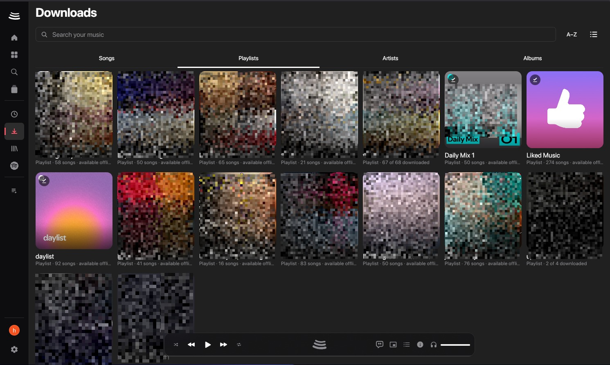

<h1 align="center">BitChord v1.11.0</h1>

**A rebuilt fork on a new foundation.** Version 1.11.0 is the first release of the rebuilt fork. The desktop application is now based on [BitChord-Desktop-Revived](https://github.com/Bntagaaa/BitChord-Desktop-Revived) by [@Bntagaaa](https://github.com/Bntagaaa) rather than the former `bitchord-desktop` line, and it is published at [kartik2005221/BitChord](https://github.com/kartik2005221/BitChord). The version number advances to 1.11.0 so that the in-app updater recognizes this release as newer than v1.10.1.

This release carries the fork's existing feature set onto the new base and introduces three additions: Downloads now opens on the Playlists tab, Home can be refreshed without restarting the application, and the main window restores its previous position and size.

## The new base

Rebuilding on BitChord-Desktop-Revived provides the following upstream desktop features:

- **Spotify library page.** The account's playlists and Liked Songs open as a full library, with tracks matched to YouTube Music as they load.
- **Blur covers.** A privacy mode applies a blur to album and artist artwork throughout the application, with per-area configuration and a global Reduce Blur override.
- **Apple Music artist page.** Artist banners, motion artwork, and the dedicated artist playback surface are ported from BitChord-PC-Continued.
- **Native fullscreen player.** The fullscreen sheet retains its original open and close motion and follows the platform's fullscreen behavior.
- **Reduce animation.** The interface can be set to a calmer presentation, with additional startup and idle-memory optimizations.
- **Local music folders.** BitChord can read a chosen folder directly, including file tags and embedded artwork.
- **Existing upstream features.** AutoMix, gapless playback with crossfade, word-synced lyrics, Discord Rich Presence, ListenBrainz, appearance customization, and the v1.9.1 feature set remain available.

## Reimplemented on the new base

The fork's own features were carried over and rebuilt on the new foundation:

1. **Playlist-level offline downloads.** Downloading a playlist or album stores the collection itself as a snapshot, in the order shown on its page. Long listings are followed to the final page before downloading begins. A track is never downloaded twice, and removing a record deletes only the files that no other record uses.
2. **Downloaded playlist updates.** When the live listing of a downloaded collection changes, the record is marked as having an update available. Updating merges the current listing with the snapshot and downloads only the tracks that are not already on disk. A downloaded page remains accessible without a network connection, playing local files and streaming the remainder when connectivity returns.
3. **Four-tab Downloads page.** Downloads provides Songs, Playlists, Artists, and Albums tabs. Downloaded playlists appear as complete, scrollable pages rather than as a section above the song list. Local Music retains its three original tabs.
4. **Built-in Last.fm scrobbling.** The fork's Last.fm application credentials are supplied at build time, so sign-in and scrobbling are available without additional configuration.
5. **Replay artist and genre charts.** Collaborations are attributed to the lead artist, artist rows include artwork and a link to the artist page, and a Top Genres chart is derived from Last.fm tags. Genre lookups can be disabled in settings.
6. **Dedicated update channel.** The fork checks its own releases rather than upstream releases. Beginning with this release, that channel points to kartik2005221/BitChord.
7. **Release pipeline.** The pipeline supports four-segment version numbers and produces the Windows and Linux packages attached to each release.

## New in v1.11.0

1. **Downloads opens on Playlists.** The Downloads page now opens on its Playlists tab. Each downloaded collection is presented as a square tile built from its cover, with download state shown on the tile, such as "12 of 15 downloading", "available offline", or "update available". Selecting a tile opens the collection's own scrollable page. Songs, Artists, and Albums remain one click away, and the Local Music page keeps its three tabs.
2. **Home refresh.** A refresh button in the Home title bar reloads the recommendations without clearing the page. Existing cards remain visible while a new set replaces them, the history cache is invalidated so identical recommendations are not served from cache, and recently played items and supplemental shelves load afterwards. The button displays a progress indicator and rejects a second request while a refresh is in progress.
3. **Window position and size memory.** The main window saves its position and dimensions while it is moved or resized, with writes debounced and flushed at shutdown. On the next launch, the saved bounds are validated against the connected monitors. If the window would open outside the visible area, it is repositioned onto an available display. Maximized, minimized, and fullscreen states do not overwrite the floating bounds, and a first launch uses the default 1220x780 size.
4. **Updated repository references.** The in-app updater, About window, Discord Rich Presence, README badges and download links, and release documentation now reference kartik2005221/BitChord. Existing installations will receive future updates through the new channel.

## Installation

Download the appropriate package for your operating system from the Assets section.

### Windows

- msi installer
- setup executable
- portable zip (no installation required)

### Linux

- deb package
- rpm package
- AppImage (mark the file as executable before launching)

## Updating from an earlier version

Releases before v1.11.0 checked the archived `bitchord-desktop` repository, which does not include this release. Version 1.11.0 must be downloaded manually once. From this release onward, the in-app updater checks kartik2005221/BitChord and will detect future releases normally.

> This is an unofficial, community-maintained fork of [BitChord Desktop Revived](https://github.com/Bntagaaa/BitChord-Desktop-Revived), which is itself an independent fork of BitChord. Android releases are available from the [original BitChord repository](https://github.com/kushagrasinghx/BitChord).

## Credits

BitChord was originally created by [@kushagrasinghx](https://github.com/kushagrasinghx).

Special thanks to [@Bntagaaa](https://github.com/Bntagaaa) and the [BitChord-Desktop-Revived](https://github.com/Bntagaaa/BitChord-Desktop-Revived) community for reviving and improving the desktop application and for the base this release is built on, to [@jackychan4891](https://github.com/jackychan4891) and [BitChord-PC-Continued](https://github.com/jackychan4891/BitChord-PC-Continued) for the Apple Music artist motion implementation and inspiration for desktop improvements, and to the original BitChord contributors and community forks for their continued contributions and inspiration.

[Source Code](https://github.com/kartik2005221/BitChord) · [Report an Issue](https://github.com/kartik2005221/BitChord/issues) · [Upstream](https://github.com/Bntagaaa/BitChord-Desktop-Revived)
