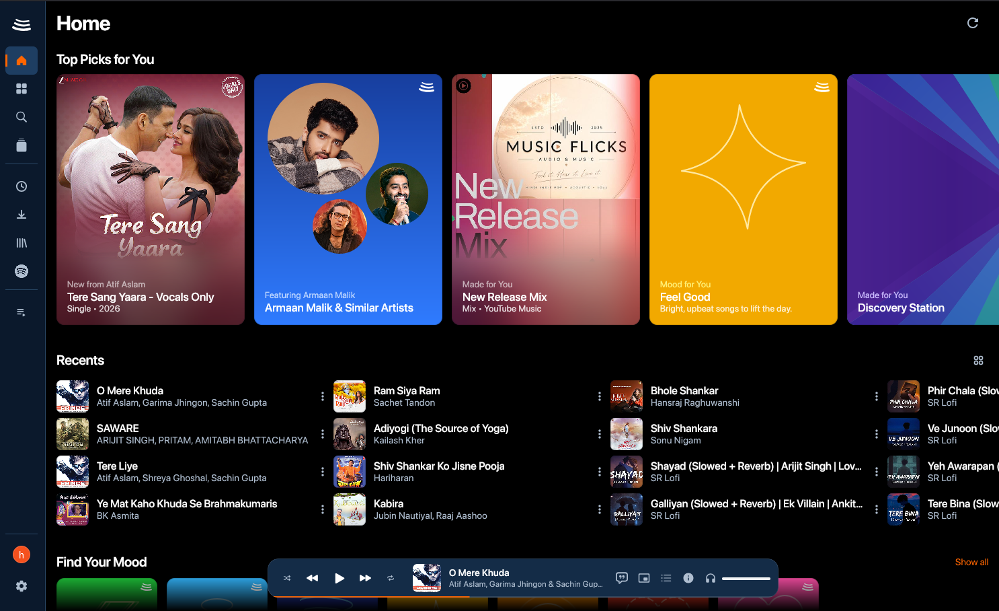

# BitChord v1.12.0 — A More Refined Desktop Experience

## Overview

Version 1.12.0 brings a refreshed desktop appearance, safer session restoration, more flexible Downloads settings, and expanded controls for artwork privacy.

## New in v1.12.0

1. **Updated desktop palette.** The dark appearance uses a black canvas with navy and blue interface surfaces and orange accents. Light appearance uses pale surfaces, navy text, and orange controls. Classic dark remains available. Album and artist artwork retains its own colors.
2. **Paused session restoration.** The desktop app can restore the personal song, queue, and playhead on the next launch, paused. It does not automatically start playback or resolve/open audio just to display the restored player. The setting can be disabled; doing so does not delete the saved session. Temporary party queues and navigation state are not restored.
3. **More Downloads preferences.** Choose which tab Downloads opens on, including the last-used tab. An optional setting can check a downloaded collection for updates when it is opened; it is off by default, and manual updating remains available. A settings action opens the existing `~/Music/BitChord` download folder without moving its contents.
4. **Artwork privacy controls.** Configure blur strength and choose independently whether artwork privacy applies to browsing, player, and PiP/external media. An explicit, temporary reveal is available for selected main-window areas. PiP and external media are not revealed by this control. The external-media option omits artwork from supported media-control metadata; text metadata may remain visible, and third-party clients may retain artwork they previously cached. These controls are not a comprehensive privacy guarantee: additional image and video paths may still display identifiable imagery.
5. **Settings navigation.** Settings subpages have a visible Back route, including nested settings pages. Pointer/swipe Back navigation is disabled; the visible Back control and Alt+Left remain available. Scrolling and unrelated player and track-row gestures are unchanged.

## Installation

Download the package for your operating system from the release Assets section. The release workflow produces the following packages:

### Linux

- AppImage — make the downloaded file executable, then launch it.
- `.deb` package
- `.rpm` package

### Windows

- Setup executable
- `.msi` installer
- Portable `.zip` archive

The workflow includes `SHA256SUMS` alongside the packages. To check downloaded files on Linux, place the checksum file in the same directory as the assets and run `sha256sum --check SHA256SUMS`.

## Updating

Use the in-app updater if it offers v1.12.0, or download and install the appropriate package from the release Assets section. Verify the downloaded package against `SHA256SUMS` where practical.

> This is an unofficial, community-maintained fork of [BitChord Desktop Revived](https://github.com/Bntagaaa/BitChord-Desktop-Revived), which is itself an independent fork of BitChord. Android releases are available from the [original BitChord repository](https://github.com/kushagrasinghx/BitChord).

## Credits

BitChord was originally created by [@kushagrasinghx](https://github.com/kushagrasinghx).

Special thanks to [@Bntagaaa](https://github.com/Bntagaaa) and the [BitChord-Desktop-Revived](https://github.com/Bntagaaa/BitChord-Desktop-Revived) community, to [@jackychan4891](https://github.com/jackychan4891) and [BitChord-PC-Continued](https://github.com/jackychan4891/BitChord-PC-Continued), and to the original BitChord contributors and community forks.

[Source Code](https://github.com/kartik2005221/BitChord) · [Report an Issue](https://github.com/kartik2005221/BitChord/issues) · [Upstream](https://github.com/Bntagaaa/BitChord-Desktop-Revived)
